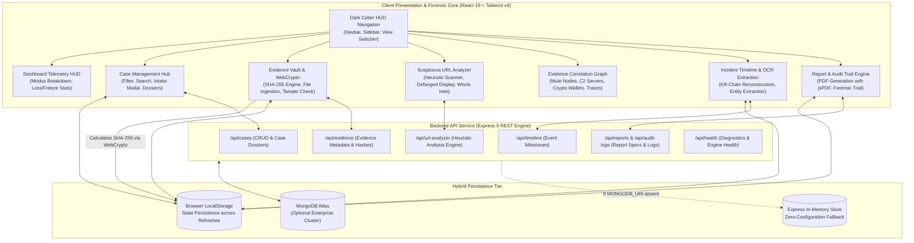

# TRACEWISE AI &mdash; AI-Powered Cyber Fraud Investigation & Digital Evidence Intelligence Platform
### 🏆 Built for Hackathon by Team MINDMESH

[](https://github.com)
[](https://github.com)
[](https://react.dev/)
[](https://vitejs.dev/)
[](https://expressjs.com/)
[](https://tailwindcss.com/)

**TRACEWISE AI** is a cyber fraud investigation, digital evidence intelligence, and forensic decision-support platform designed for Law Enforcement Cyber Cells (1930 Helpline), Bank Fraud Risk Management (FRM) units, and cybersecurity incident responders.

---

## ⚡ Quick Start for Hackathon Judges

Judges can explore the entire platform immediately using the **"Load Demo Case"** feature:
1. Click the purple **"Load Demo Case"** button on the Top Navigation Bar, Dashboard, or Cases view.
2. Choose from three realistic fictional investigation scenarios:
   - 🛡️ **Operation FakeSBI** (`TW-2026-8941`): Multi-State UPI APK Trojan & SMS Forwarder Ring with ₹38.5 Lakhs defrauded and ₹31.2 Lakhs frozen.
   - 📱 **Operation SilkRoad-Mule** (`TW-2026-8938`): Telegram Part-Time Review task fraud layered into USDT crypto mixers.
   - ⚖️ **Operation DigitalArrest** (`TW-2026-8935`): High-profile Skype extortion impersonating CBI/Cyber Crime Police officers.
3. Select **"Load Case Dossier"**, **"Explore in Evidence Graph"**, or **"Inspect Forensic Timeline"** for instant 1-click drill-down.

---

## 🏗️ System Architecture



---

## 🌟 Implemented Features & Core Modules

### 1. Forensic Command Center (Dashboard)
- Real-time cyber metrics: Active Fraud Cases, Defrauded Loss vs. Secured/Frozen Funds (₹5.84 Cr / $702K), 100% SHA-256 verified integrity rate.
- Modus operandi breakdown charts analyzing APK malware, Telegram task fraud, and Digital Arrest schemes.
- Live threat activity stream and instant case triage drawers.

### 2. Case Management Module (Cases)
- Searchable, filterable case repository with multi-attribute filtering (Priority, Status, Incident Type).
- Comprehensive case creation modal with real-time field validation.
- Detailed case dossier with victim profile, modus operandi, AI recommendations, linked accounts, and incident history.
- Safe delete workflows with double confirmation dialogues.

### 3. Cryptographic Digital Evidence Vault (Evidence Vault)
- **Web Crypto API SHA-256 / SHA-512 Calculation:** Client-side cryptographic hashing ensures zero file corruption during intake.
- File integrity inspection with bitstream check indicators (`0 Bit Deviation`).
- Evidence classification for APKs, PCAPs, bank statements, chat logs, call recordings, and scam screenshots.
- Chain of Custody logging with timestamps and officer credentials.
- Court-admissible text manifest export.

### 4. Suspicious URL & Phishing Sandbox Analyzer (URL Analyzer)
- Transparent local heuristic scanning checking SSL status, high-risk TLDs (`.xyz`, `.top`, `.in.net`), domain age, brand impersonation keywords (SBI, HDFC, KYC, OTP), and IP-based hosts.
- Defanged URL display (e.g., `hxxps://secure-sbi-kyc-verify-portal[.]in[.]net`) to avoid accidental navigation.
- Risk ratings (Low, Medium, High) with explicit explainability indicators.
- Automated Section 79(3)(b) IT Act takedown notice drafting.

### 5. Interactive Evidence Correlation Graph (Evidence Graph)
- Entity relationship network representing Case Dossiers, Suspect Kingpins, Bank Mule Accounts, UPI VPAs, Crypto Wallets, Rogue Domains, and Telecom SIMs.
- Clear distinction between confirmed data matches (solid cyan lines) and AI-suggested potential links (dashed purple lines).
- Interactive node inspector displaying linked evidence IDs and rationale for each connection.
- Zoom, pan, reset, fit-to-screen controls and node-type filtering.

### 6. Incident Timeline & Evidence Extraction (Timeline)
- Chronological forensic reconstruction across 7 cyber kill-chain phases (Reconnaissance to Asset Freezing).
- Automated OCR and regex extraction extracting phone numbers, email addresses, URLs, UPI VPAs, and transaction IDs from uploaded documents.
- Review and verify workflow allowing investigators to correct extracted values before committing to the timeline.

### 7. Professional Case Report & Audit Trail (Reports)
- Instant generation of court-ready PDF case dossiers using `jspdf`.
- Detailed evidence inventory with SHA-256 cryptographic signatures.
- Forensic audit log recording upload, view, analysis, edit, and report generation events.
- Clear distinction between actual recorded events (`LIVE_RECORDED`) and initial demo baseline events (`SYSTEM_RECORDED`).
- Prominent statutory disclaimers regarding digital evidence integrity vs. independent legal guilt.

---

## 💻 Tech Stack

- **Frontend:** React 19, Vite 8, Tailwind CSS v4, Lucide React icons
- **Libraries:** jsPDF (Client-side PDF generation), Cytoscape / SVG graph engine
- **Backend:** Node.js, Express 5, CORS, dotenv
- **Database (Optional):** MongoDB Atlas with Mongoose (gracefully falls back to zero-cloud in-memory mode if unset)
- **Forensic Standards:** ISO/IEC 27037:2012 guidelines, Section 65B Indian Evidence Act / Section 63 BSA 2023 compliance framing

---

## ⚙️ Environment Variables

Create a `.env` file in the project root:

```env
# Server Port
PORT=5000

# Environment Mode
NODE_ENV=development

# Optional: MongoDB Atlas Connection URI
# Leave unset or empty to use high-speed in-memory store
# MONGODB_URI=mongodb+srv://<user>:<password>@cluster0.abcde.mongodb.net/tracewise?retryWrites=true&w=majority

# Client CORS Allowed Origin
CLIENT_ORIGIN=*

# Frontend API Base URL (if frontend is hosted on separate domain)
# VITE_API_URL=http://localhost:5000
```

> **Security Note:** Never commit production credentials, database passwords, or private keys to git. All client-side code uses environment variables via Vite's `import.meta.env` and contains zero hardcoded secrets.

---

## 🚀 Running Locally

### Option 1: Frontend Development Mode (Vite)
```bash
# 1. Install dependencies
npm install

# 2. Start Vite development server
npm run dev
```
Open **`http://localhost:5173`** in your browser. All features work immediately with local browser persistence (`localStorage`) and preloaded realistic forensic scenarios.

### Option 2: Fullstack Mode (Express API + React Production Build)
```bash
# 1. Build the frontend production assets
npm run build

# 2. Start the Express backend server
npm run server
```
Open **`http://localhost:5000`** in your browser. The Express server serves both the REST API endpoints (`/api/*`) and the React client application (`/`).

---

## ⚖️ Demo Limitations & Forensic Ethics Notice

1. **Cryptographic Hash Verification:**
   The calculated SHA-256 digest proves that a digital file has not changed since the moment the hash was computed. It verifies **cryptographic integrity**, not the veracity or truthfulness of the file's contents.
2. **Transparent Heuristic URL Analysis:**
   In the absence of paid enterprise threat intelligence feeds (VirusTotal / AlienVault OTX), URL risk levels (Low/Medium/High) are generated via local explainable heuristics. They provide fast triage flags and are explicitly labeled as heuristic assessments.
3. **Legal Decision Support:**
   TRACEWISE AI is an investigative decision-support system. It produces data correlations, kill-chain timelines, and draft FIR annexures to assist human investigators, but does not make autonomous legal judgements or establish guilt.
4. **Data Privacy:**
   Sample data used across all cases, bank accounts, suspect nodes, and phone numbers are realistic fictional scenarios created for demonstration and hackathon evaluation purposes.

---

## 🌐 Deployment Instructions

### Deploy Frontend to Vercel
1. Push the repository to GitHub.
2. Log into [Vercel](https://vercel.com) and click **"New Project"**.
3. Select your repository.
4. Set Build Settings:
   - **Framework Preset:** Vite
   - **Build Command:** `npm run build`
   - **Output Directory:** `dist`
5. Vercel will automatically read `vercel.json` for client-side single page application routing.
6. Click **Deploy**.

### Deploy Full-Stack App to Render
1. Create a [Render](https://render.com) account.
2. Click **"New +"** and choose **"Web Service"**.
3. Connect your GitHub repository.
4. Configure service settings (or use `render.yaml` Blueprint):
   - **Environment:** `Node`
   - **Build Command:** `npm install && npm run build`
   - **Start Command:** `npm run start`
   - **Plan:** Free
5. (Optional) In **Environment Variables**, add:
   - `NODE_ENV`: `production`
   - `PORT`: `10000`
   - `MONGODB_URI`: `<your-mongodb-atlas-uri>` (optional)
6. Click **"Create Web Service"**. Once deployed, Render will provide a public HTTPS URL (e.g., `https://tracewise-ai-platform.onrender.com`).

### Deploy via Local Tunnel for Instant Demo (Alternative)
To share the locally running instance instantly during a presentation:
```bash
# Start frontend on port 5173
npm run dev

# In another terminal, create a secure public tunnel
npx localtunnel --port 5173
# Or using ngrok:
# ngrok http 5173
```

---

## 👥 Hackathon Team MINDMESH

- **Sneha KR** &mdash; Lead Digital Forensics Architect & Core Platform Engineering
- **Rohan Mehta** &mdash; Cyber Threat Intelligence & Reverse Engineering
- **Pooja Iyer** &mdash; Evidence Custody & Legal Compliance Lead
- **Arjun Das** &mdash; OSINT & Financial Mule Graph Specialist

---

*TRACEWISE AI &mdash; Empowering Cyber Crime Units with Automated Intelligence, Cryptographic Integrity, and Rapid Asset Recovery.*
